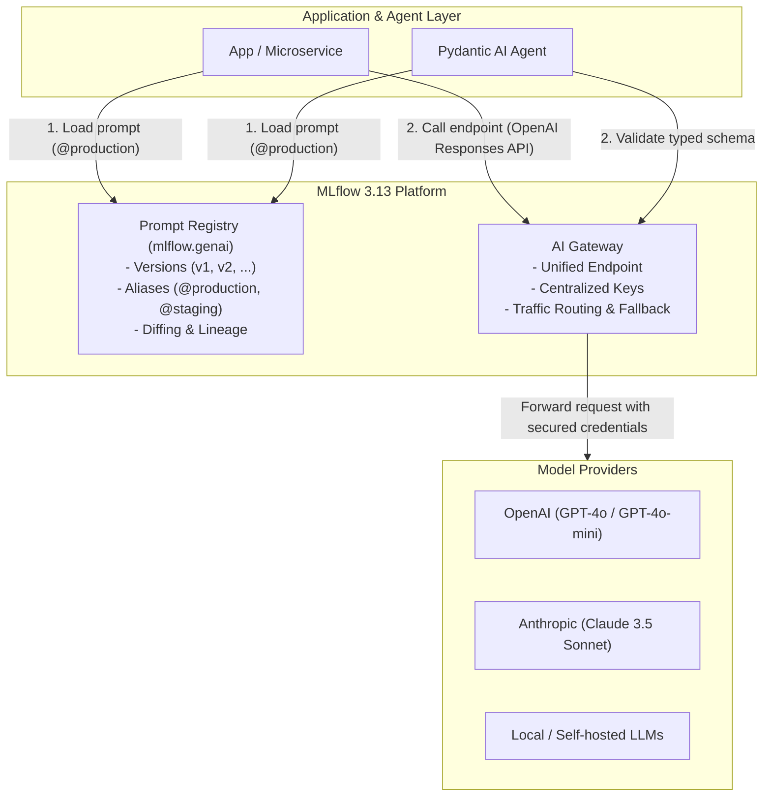

# AI Gateway and Prompt Registry using MLflow 3.13

[](https://www.python.org/)
[](https://mlflow.org/)
[](https://ai.pydantic.dev/)
[](LICENSE)

A complete hands-on guide, workshop, and reference implementation for governing LLM prompts and centralizing model access using **MLflow 3.13 Prompt Registry** and **AI Gateway**.

---

## 📌 Table of Contents

- [Overview](#-overview)
- [Key Features](#-key-features)
- [Architecture & Workflow](#-architecture--workflow)
- [Repository Structure](#-repository-structure)
- [Prerequisites & Installation](#-prerequisites--installation)
- [Quickstart Guide](#-quickstart-guide)
  - [1. Configure Environment](#1-configure-environment)
  - [2. Start the MLflow Tracking Server](#2-start-the-mlflow-tracking-server)
  - [3. Run the Workshop Notebook](#3-run-the-workshop-notebook)
  - [4. View Presentation Slides](#4-view-presentation-slides)
- [Core Concepts Walkthrough](#-core-concepts-walkthrough)
  - [MLflow Prompt Registry](#1-mlflow-prompt-registry)
  - [MLflow AI Gateway](#2-mlflow-ai-gateway)
  - [Pydantic AI Integration](#3-pydantic-ai-integration)
- [Documentation & References](#-documentation--references)
- [License](#-license)

---

## 🚀 Overview

In production Generative AI applications, treating prompts as hardcoded strings and managing API keys in application microservices creates severe reliability, security, and governance challenges:

- **Prompt Chaos:** Changing a prompt requires redeployment; past versions are lost; no safe rollback.
- **Provider Lock-In & Sprawl:** Direct API dependencies make switching providers difficult; credential sprawl leaks secrets.
- **Vibe-Based Iteration:** Prompt updates lack systematic lineage and benchmark evaluation.

This repository provides an enterprise-ready blueprint using **MLflow 3.13** to:
1. **Govern Prompts as Versioned Assets** via the **MLflow Prompt Registry** (`mlflow.genai`).
2. **Centralize & Secure LLM Access** via the **MLflow AI Gateway** (`OpenAI Responses API` / deployments).
3. **Build Type-Safe Agents** integrating the gateway with **Pydantic AI**.

---

## 🌟 Key Features

| Capability | What MLflow 3.13 Provides |
|---|---|
| **Immutable Versioning** | Git-like commit versions for every prompt template iteration. |
| **Dynamic Aliasing** | Mutable tags (`@production`, `@staging`, `@champion`) enable instant rollbacks without changing code. |
| **Lineage & Tracing** | Full traceability linking prompts, traces, evaluation runs, and model outputs. |
| **AI Gateway Centralization** | Unified API for multiple LLM providers, centralized API secret management, and rate limiting. |
| **Traffic Routing & Fallbacks** | Multi-route load shedding and fallback models to eliminate downtime. |
| **Structured Output with Pydantic AI** | Type-safe response validation through centralized gateway endpoints. |

---

## 📐 Architecture & Workflow



---

## 📂 Repository Structure

```text
├── guidelines.md          # Comprehensive technical guidelines & cheat sheet (900+ lines)
├── mlflow_3_demo.ipynb    # Interactive hands-on workshop notebook
├── slides.md              # Marp markdown presentation deck
├── slides.html            # Compiled interactive HTML presentation slides
├── Docker.env             # Template environment configuration
├── pyproject.toml         # Dependencies managed with uv / pip
├── uv.lock                # Deterministic dependency lockfile
├── .gitignore             # Standard ignore rules for Python, venv, and checkpoints
└── README.md              # Project documentation and quickstart
```

---

## 🛠️ Prerequisites & Installation

### Requirements
- **Python:** `>= 3.12`
- **Package Manager:** [`uv`](https://github.com/astral-sh/uv) (recommended) or `pip`
- **OpenAI API Key** (or compatible provider credentials)

### 1. Clone the Repository
```bash
git clone https://github.com/AkbarIqbnuPrayoga/AI-Gateway-and-Prompt-Registry.git
cd AI-Gateway-and-Prompt-Registry
```

### 2. Set Up Virtual Environment

**Using `uv` (Recommended):**
```bash
# Create virtual environment and sync dependencies from lockfile
uv sync
```

**Using standard `pip`:**
```bash
python -m venv .venv

# Windows:
.venv\Scripts\activate

# macOS / Linux:
source .venv/bin/activate

pip install -e .
```

---

## ⚡ Quickstart Guide

### 1. Configure Environment

Copy `Docker.env` to `.env` (or configure your shell variables):
```bash
cp Docker.env .env
```
Edit `.env` to set your credentials and configuration:
```env
MLFLOW_TRACKING_URI=http://localhost:5000
MLFLOW_WORKSPACE=default
MLFLOW_GATEWAY_ENDPOINT=my-ai-gateway-endpoint
MLFLOW_EXPERIMENT_NAME=mlflow-3-genai-workshop
MLFLOW_PROMPT_NAME=workshop-dummy-prompt
OPENAI_API_KEY=your-openai-api-key-here
```

### 2. Start the MLflow Tracking Server

Start the MLflow server locally with gateway support enabled:
```bash
mlflow server --host 127.0.0.1 --port 5000
```
Open **[http://127.0.0.1:5000](http://127.0.0.1:5000)** in your browser to inspect the **Prompts**, **Experiments**, and **Models** tabs.

### 3. Run the Workshop Notebook

Launch Jupyter Lab / Notebook:
```bash
uv run jupyter lab
# or: jupyter lab
```
Open **[`mlflow_3_demo.ipynb`](file:///./mlflow_3_demo.ipynb)** to execute the hands-on tutorial:
1. **Prompt Registry:** Register v1, load parameters, create improved v2, run diff comparison, and assign `@production` alias.
2. **AI Gateway:** Query models via the unified OpenAI Responses API compatibility layer.
3. **Pydantic AI:** Route structured agents through the gateway with typed Pydantic models.

### 4. View Presentation Slides

Open [`slides.html`](file:///./slides.html) in any modern browser to view the Marp-generated slide deck, or edit [`slides.md`](file:///./slides.md) using the VS Code Marp extension.

---

## 💡 Core Concepts Walkthrough

### 1. MLflow Prompt Registry

Prompts are registered, versioned, and loaded via `mlflow.genai`:

```python
import mlflow
from mlflow.genai import register_prompt, load_prompt, set_prompt_alias

mlflow.set_tracking_uri("http://127.0.0.1:5000")

# 1. Register a prompt version
prompt_v1 = register_prompt(
    name="customer-support-triage",
    template="Categorize this customer request into {categories}. Query: {query}",
    commit_message="Initial triage prompt",
)

# 2. Promote to production via alias
set_prompt_alias(name="customer-support-triage", alias="production", version=prompt_v1.version)

# 3. Load by alias in your production services (no hardcoded versions!)
prod_prompt = load_prompt("prompts:/customer-support-triage@production")
formatted_text = prod_prompt.format(categories="Billing, Technical, Sales", query="How do I cancel my plan?")
```

### 2. MLflow AI Gateway

Application code talks to the MLflow AI Gateway using the standard OpenAI client, referencing the endpoint name as the model:

```python
from openai import OpenAI

client = OpenAI(
    base_url="http://127.0.0.1:5000/gateway/openai/v1",
    api_key="not-needed",  # Gateway manages upstream keys
)

response = client.chat.completions.create(
    model="my-ai-gateway-endpoint",
    messages=[{"role": "user", "content": formatted_text}],
)
print(response.choices[0].message.content)
```

### 3. Pydantic AI Integration

Build type-safe GenAI agents using Pydantic AI backed by your MLflow AI Gateway:

```python
from pydantic import BaseModel, Field
from pydantic_ai import Agent
from pydantic_ai.models.openai import OpenAIModel

class TicketClassification(BaseModel):
    category: str = Field(description="Primary category")
    urgency: int = Field(ge=1, le=5, description="Urgency score from 1 (low) to 5 (critical)")
    requires_human_escalation: bool

gateway_model = OpenAIModel(
    model_name="my-ai-gateway-endpoint",
    base_url="http://127.0.0.1:5000/gateway/openai/v1",
    api_key="not-needed",
)

agent = Agent(gateway_model, result_type=TicketClassification)
result = agent.run_sync("URGENT: Our production database is dropping connections!")
print(result.data)
```

---

## 📖 Documentation & References

- Detailed technical notes and patterns: **[`guidelines.md`](guidelines.md)**
- [MLflow GenAI & Prompt Registry Docs](https://mlflow.org/docs/latest/llms/prompt-registry/index.html)
- [MLflow AI Gateway / Deployments](https://mlflow.org/docs/latest/llms/deployments/index.html)
- [Pydantic AI Documentation](https://ai.pydantic.dev/)

---

## 📄 License

This project is licensed under the terms described in the [LICENSE](LICENSE) file.
